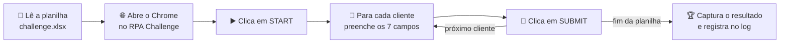

# 🤖 RPA Challenge com UiPath

> Robô que lê uma planilha Excel com dados de clientes e preenche automaticamente o formulário do [RPA Challenge](https://rpachallenge.com/), concluindo as 10 rodadas do desafio sem nenhuma digitação manual.


---

## 📌 Sobre o projeto

O **RPA Challenge** é o desafio clássico para quem está começando no mundo da automação de processos (RPA). O site apresenta um formulário com 7 campos que precisa ser preenchido **10 vezes seguidas**, uma vez para cada cliente da planilha.

O detalhe que torna o desafio interessante: **a cada rodada os campos mudam de posição na tela**. Um robô que clica sempre no mesmo lugar falha logo na segunda rodada.

Este projeto resolve o desafio com o **UiPath Studio**, usando seletores baseados nos **rótulos dos campos**. Assim o robô sempre encontra o campo certo, não importa onde ele esteja.

---

## ⚙️ Como o robô funciona



1. **Leitura da planilha:** o *Read Range Workbook* carrega a aba `Sheet1` em uma `DataTable`.
2. **Abertura do site:** o *Use Browser* abre o Chrome em `https://rpachallenge.com/`.
3. **Início do desafio:** o robô clica no botão **START**, que dispara o cronômetro.
4. **Preenchimento:** um *For Each Row in Data Table* percorre cada cliente e usa *Type Into* em cada campo.
5. **Envio:** o robô clica em **SUBMIT** e passa para o próximo cliente.
6. **Resultado:** ao final, o *Get Text* captura a mensagem **"Congratulations!"** com a taxa de acerto e o tempo, e o resultado é registrado no log.

### 🎯 O segredo: seletores por rótulo

Em vez de depender da posição ou de atributos que mudam a cada rodada, cada campo é localizado a partir do seu rótulo:

```xml
<webctrl aaname='First Name' tag='LABEL' />
<nav up='1' />
<webctrl tag='INPUT' />
```

Ou seja: *"encontre o rótulo **First Name**, suba um nível e pegue o campo de texto que está ali dentro"*. É isso que permite ao robô encontrar o campo certo mesmo com o embaralhamento a cada rodada.

---

## 🗂️ Estrutura do repositório

```
Rpa Challenge/
├── Main.xaml             # Fluxo principal do robô
├── project.json          # Configurações e dependências do projeto
├── project.uiproj        # Arquivo de projeto do UiPath Studio
├── entry-points.json     # Ponto de entrada (Main.xaml)
├── .objects/             # Object Repository
├── .screenshots/         # Capturas dos elementos usadas nas atividades
├── .settings/            # Configurações das atividades (Debug/Release)
└── README.md
```

---

## 🛠️ Tecnologias utilizadas

| Ferramenta | Função |
|---|---|
| **UiPath Studio** | Desenvolvimento do robô (fluxo em VB.NET) |
| **UiPath.Excel.Activities** | Leitura da planilha de clientes |
| **UiPath.UIAutomation.Activities** | Interação com o navegador (cliques, digitação e leitura de texto) |
| **UiPath.System.Activities** | Variáveis, laços e mensagens de log |
| **Google Chrome** | Navegador onde o desafio é executado |

---

## 📊 Planilha de entrada

A planilha `challenge.xlsx` é disponibilizada pelo próprio site (botão **DOWNLOAD EXCEL**) e contém 10 clientes com as colunas:

| Coluna | Exemplo |
|---|---|
| First Name | John |
| Last Name | Smith |
| Company Name | IT Solutions |
| Role in Company | Analyst |
| Address | 98 North Road |
| Email | jsmith@itsolutions.co.uk |
| Phone Number | 40716543298 |

---

## ▶️ Como executar

### Pré-requisitos

- [UiPath Studio](https://www.uipath.com/product/studio) instalado
- Google Chrome com a **extensão do UiPath** ativada

### Passo a passo

1. Clone o repositório:
   ```bash
   git clone https://github.com/luisguilhermecunhamariano-del/RPA-CHallenge-UiPath.git
   ```
2. Baixe a planilha no site [rpachallenge.com](https://rpachallenge.com/) clicando em **DOWNLOAD EXCEL**.
3. Salve o arquivo em `C:\Users\<seu-usuário>\Downloads\challenge.xlsx`.
4. Abra o `project.json` no UiPath Studio e aguarde a restauração das dependências.
5. No `Main.xaml`, ajuste a variável `strCaminhoPlanilha` para o caminho onde você salvou a planilha.
6. Clique em **Run** (ou `Ctrl + F5`) e assista ao robô trabalhar. 🚀

---

## 🧩 Variáveis do fluxo

| Variável | Tipo | Descrição |
|---|---|---|
| `strCaminhoPlanilha` | String | Caminho do arquivo `challenge.xlsx` |
| `dtDadosCliente` | DataTable | Dados dos clientes lidos da planilha |
| `strUrlRpaChallenge` | String | Endereço do site do desafio |
| `strResultadoFinal` | String | Mensagem final com a taxa de acerto e o tempo |

---

## ✅ Funcionalidades

- ✅ Leitura automática de planilha Excel
- ✅ Abertura e controle do navegador Chrome
- ✅ Preenchimento dos 7 campos para cada cliente
- ✅ Seletores robustos que se adaptam à mudança de posição dos campos
- ✅ Captura do resultado final do desafio
- ✅ Mensagens de log em cada etapa do processo

---

## 🚀 Próximas melhorias

- [ ] Baixar a planilha automaticamente pelo próprio robô
- [ ] Usar caminho relativo para a planilha (rodar em qualquer computador sem ajustes)
- [ ] Adicionar tratamento de exceções com *Try Catch*
- [ ] Salvar o resultado final em um arquivo de relatório

---

## 🤝 Contribuição

Sugestões e melhorias são muito bem-vindas! Fique à vontade para abrir uma *issue* ou enviar um *pull request*.

---

⭐ Se este projeto te ajudou ou te inspirou a começar no RPA, deixe uma estrela no repositório!

`#RPA` `#UiPath` `#Automação` `#RPAChallenge` `#Excel`
